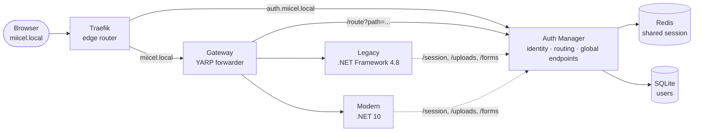
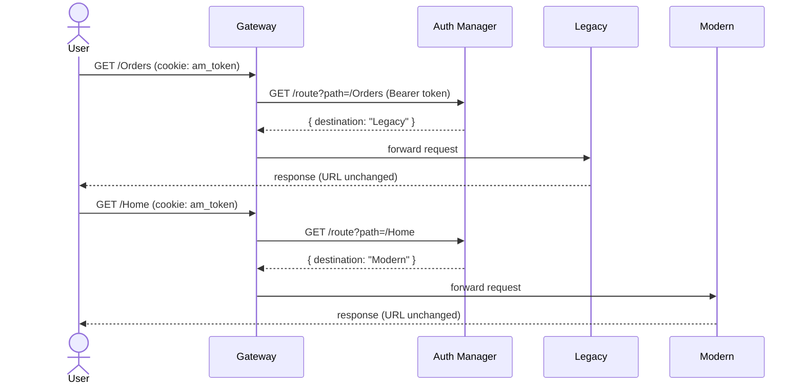

# net-migration-demo

A working proof of concept for migrating a .NET Framework 4.8 system to .NET 10
one screen at a time, without breaking the user's login, session, or the pages
that haven't moved yet.

Both apps sit behind the same public domain. The browser's URL never changes,
and never reveals which app actually answered a request — that decision is
made on the server, per request, based on which pages have been migrated so
far.

## Projects

| Project | What it is | Port |
|---|---|---|
| [auth-manager](auth-manager/) | Identity, shared session, page routing, and the two global endpoints (`/uploads`, `/forms`) that neither app owns | 5000 |
| [legacy-web-net48](legacy-web-net48/) | The existing system — ASP.NET MVC 5 on .NET Framework 4.8 | 5001 (IIS Express) |
| [modern-web-net10](modern-web-net10/) | The system it's migrating to — ASP.NET Core MVC on .NET 10 | 5002 |
| [gateway-net10](gateway-net10/) | A YARP reverse proxy that decides, per request, which app answers | 5003 |
| [traefik](traefik/) | The public edge — one domain, routed to the gateway and to Auth Manager | 80 |

## Architecture



## How a request is routed

Every request carries the same cookie (`am_token`, a JWT) regardless of which
app serves it. The gateway asks Auth Manager, on every request, which app
currently owns that page — so moving a page from legacy to modern is a one-line
config change, not a redeploy of routing logic.



Today's routing table (`Routing:Pages` in Auth Manager's `appsettings.Development.json`):

| Page | Served by |
|---|---|
| `/Home` | Modern |
| `/Profile` | Modern |
| `/Orders` | Legacy |
| everything else | Legacy (default) |

## What each mechanism solves

- **Password migration** — old .NET Framework password hashes (format v2) are
  verified and silently upgraded to the new format (v3) on first successful
  login. See [auth-manager](auth-manager/#how-the-password-migration-works).
- **Shared session** — both apps read the same session object (company,
  name, role) from Redis through Auth Manager, so neither can drift from the
  other.
- **Global endpoints** — `/uploads` and `/forms` are owned by neither app.
  Both call the exact same contract and see the exact same data, regardless
  of which one made the call. Contrast this with each app's own isolated
  `/Uploads` page, which intentionally does **not** share data, to make the
  difference visible.
- **Zero-downtime page migration** — moving a page from legacy to modern is a
  one-line change to the routing table in Auth Manager. No redeploy of the
  app that's giving up the page, no redeploy of the one receiving it.

## Running the demo

```bash
docker start authdemo-redis
```

```bash
cd traefik && docker compose up -d
```

```bash
cd auth-manager/src/AuthManager.Api && dotnet run
```

```bash
cd legacy-web-net48 && "C:\Program Files\IIS Express\iisexpress.exe" /path:"<repo>\legacy-web-net48" /port:5001
```

```bash
cd modern-web-net10 && dotnet run
```

```bash
cd gateway-net10 && dotnet run
```

Then open `http://miicel.local/Account/Login` — everything goes through the
gateway behind Traefik on port 80; the URL never changes no matter which app
answers.

Test users: `user1` / `12345678`, `user2` / `AbcD$1234`.

See each project's own README for details specific to that piece.
